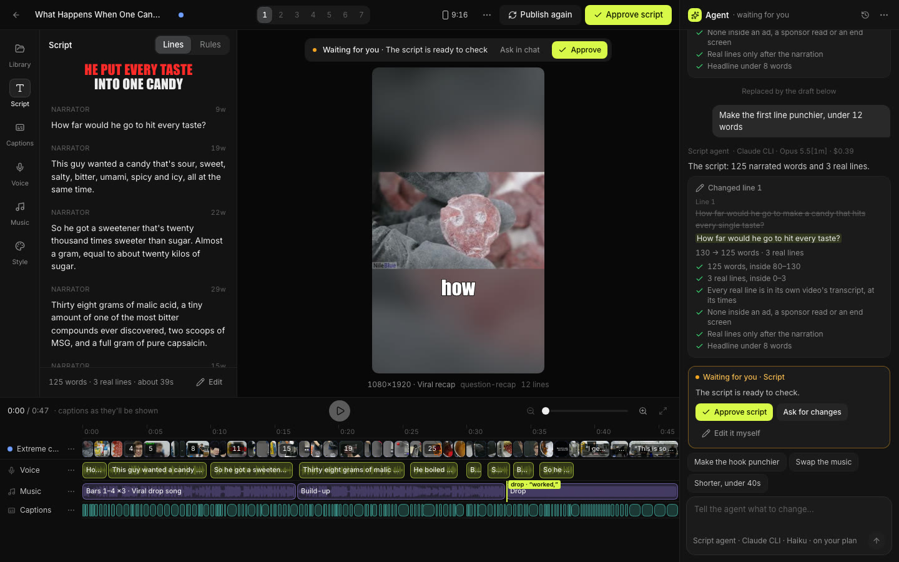
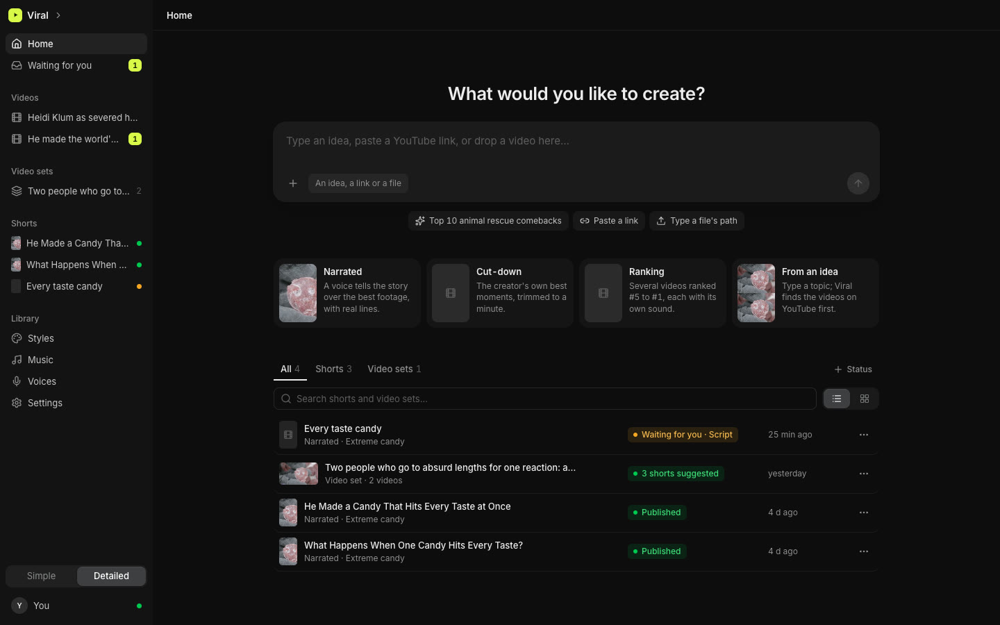
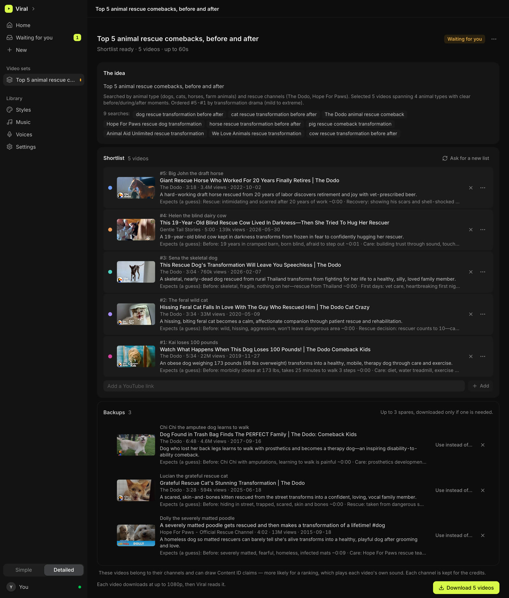
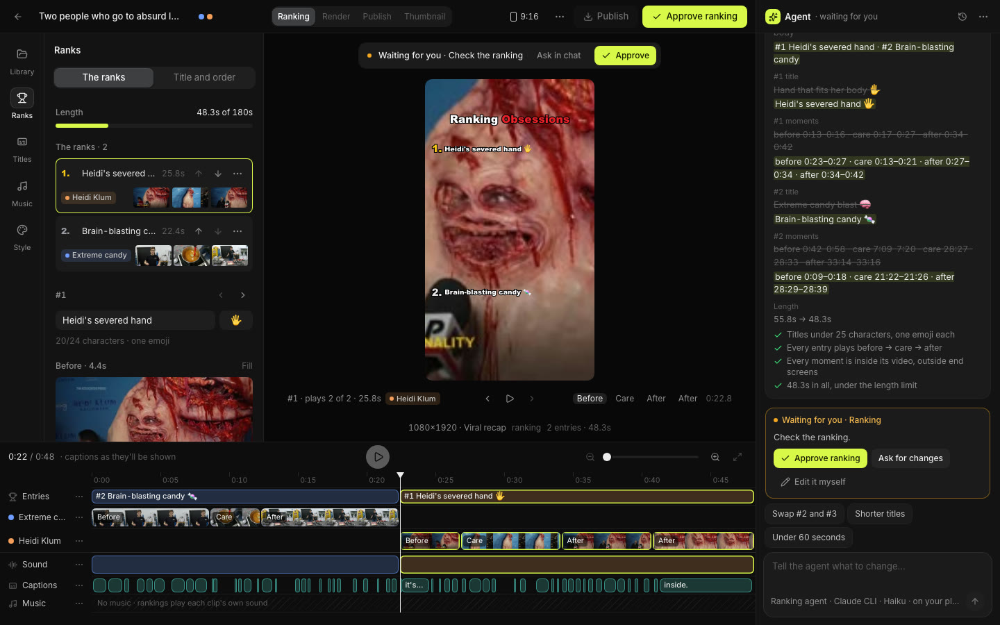
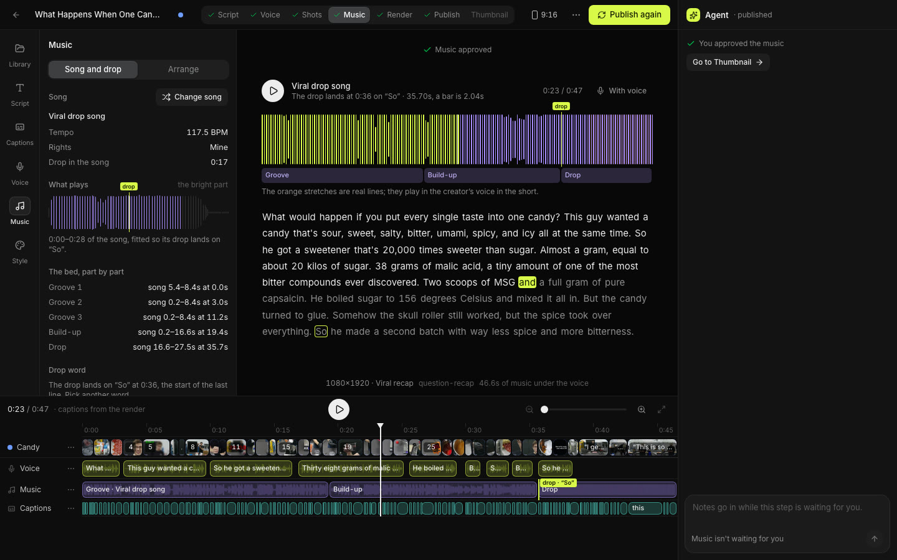
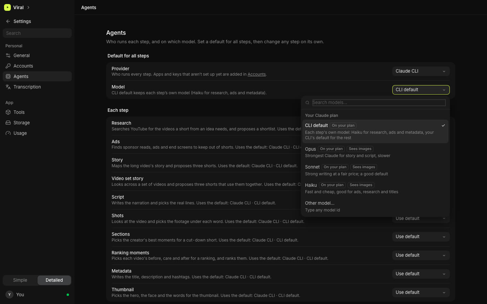

# Viral

Viral turns long videos into viral shorts. Give it a video, a few links, or just an idea, and it writes, voices,
cuts, scores and renders a 9:16 short, stopping at each step so you can approve it, ask for changes in a chat with the
agent, or edit it yourself.

It's a desktop app (Electron) for macOS. All the work happens on your own machine: your videos, shorts and keys stay
with you.



## What it makes

- **Narrated shorts:** a voiceover tells the story over the best footage, with the creator's real lines cut in.
- **Story recaps:** a longer narrated cut (60–120 s) that covers the whole story and ends on a long real take.
- **Cut-downs:** the creator's own best moments, trimmed on whole sentences.
- **Rankings:** "Top 5 …" countdowns across several videos, with #1 last.
- **From several videos:** up to 10 videos in one short, each clip labelled by its video.
- **From an idea:** type a topic; Viral searches YouTube, shows you a shortlist to approve, then downloads and reads the
  videos.

Every short also gets a thumbnail, a title with alternates, a description, hashtags, captions (`.srt`) and credits.
Finished files land in `~/.viral/renders/`.

| Start from an idea, a link or a file | Approve the videos Viral found |
| --- | --- |
|  |  |
| **Ask the agent for changes in chat** | **Music fitted so the drop lands on a word** |
|  |  |

## How it works

One headless server owns the pipeline: agent steps, media jobs, approvals and state. The desktop app, the web UI and
the dev CLI are thin clients over a typed WebSocket (Effect RPC).

```
idea / link / file
  → source: download (≤1080p), transcribe, contact sheets, ads to keep out
  → story: three proposed shorts, the best fit for the video first
  → script → voice → shots → music → render → publish → thumbnail      (narrated)
  → sections → render → publish → thumbnail                            (cut-down)
  → moments → render → publish → thumbnail                             (ranking)
```

Each agent step runs on the provider you choose for it:

- **Signed-in CLIs:** the Claude CLI (the default), Codex, OpenCode. These run on your existing plan.
- **API keys:** Anthropic, OpenAI, Google, OpenRouter, or the Vercel AI Gateway. These are billed per use.

Keys are entered in Settings › Accounts and stored in the macOS Keychain. A variable in `.env` overrides a saved key.
Settings › Usage shows what each step cost, split between money billed and value used from a plan.



## Requirements

- macOS (Apple Silicon recommended: local Whisper transcription and Apple Vision cut-outs)
- Node 24 and [bun](https://bun.sh) (package manager)
- At least one agent provider: the [Claude CLI](https://docs.anthropic.com/en/docs/claude-code) signed in, Codex,
  OpenCode, or an API key
- An [ElevenLabs](https://elevenlabs.io) key for voiceovers (narrated shorts)
- Optional: an xAI key for Grok transcription (otherwise Whisper runs locally)

ffmpeg, ffprobe, uv and yt-dlp are downloaded on first run into Viral's tools folder. Nothing needs Homebrew.

## Getting started

```bash
bun install            # also patches TypeScript with @effect/tsgo
cp .env.example .env   # optional: keys here override the Keychain
bun run dev            # the web dev server + the desktop app, which starts the server
```

Or store keys in the Keychain instead of `.env`:

```bash
security add-generic-password -s viral -a elevenlabs -w
```

To open a separate library, set `VIRAL_HOME`:

```bash
VIRAL_HOME=~/.viral/work/my-test bun run dev
```

## Commands

```bash
bun run dev              # desktop app + web UI + server (Ctrl-C stops all)
bun run dev:server       # the server alone (port 3410), for the CLI or a browser
bun run dev:web          # the UI alone at http://127.0.0.1:5733
bun run cli              # dev client; prints every command
bun run typecheck        # effect-tsgo per project: node, ui, web, desktop
bun run test             # unit tests (about a minute)
bun run test:golden      # render goldens + transcription (slow; needs fixtures:sync)
bun run test:live        # one tiny real task per configured provider
bun run cli eval …       # compare models on the agent steps, with a budget
bun run package:desktop  # build Viral.app (unsigned)
```

A short from start to finish with the dev client:

```bash
bun run cli source add --file ~/videos/candy.mp4 --rights owned
bun run cli source run <source-id>                # transcribe → contact sheets → ads → story
bun run cli project from-proposal <source-id> <n>
bun run cli project run <project-id>              # stops at each gate
bun run cli approve <request-id> | reject <request-id> "note"
```

## Repository layout

```
apps/server/     the Effect server: one folder per domain (sources, story, script, voice, shots, render, …)
apps/web/        the UI: React 19, Vite (vite-plus), TanStack Router, Effect atoms, Tailwind v4
apps/desktop/    the Electron shell: starts the server, opens the UI, window chrome, updates
apps/cli/        the dev client over RPC
packages/
  contracts/     wire schemas and RPC groups, shared by server and clients
  ui/            @viral/ui: design tokens and primitives on Base UI
  provider-*/    agent providers: Claude CLI, Codex, OpenCode, the AI SDK (keys + Gateway), test replay
```

[AGENTS.md](AGENTS.md) is the detailed guide: every domain, the conventions, and how the pipeline fits together.

## Stack

Effect v4 end to end (services, schemas, RPC, processes), Node 24 running TypeScript directly, SQLite per library,
Python scripts run through uv for media work (renderers, music fitting, cut-outs), and React 19 on the client.

## Rights

Viral downloads and edits other people's videos only when you ask it to. Each source records who owns it, every short
credits the channels whose footage plays, and Viral never works around a blocked download. Footage and music you don't
own can draw Content ID claims; check the rights before you publish.

## License

Not yet decided. All rights reserved for now.
